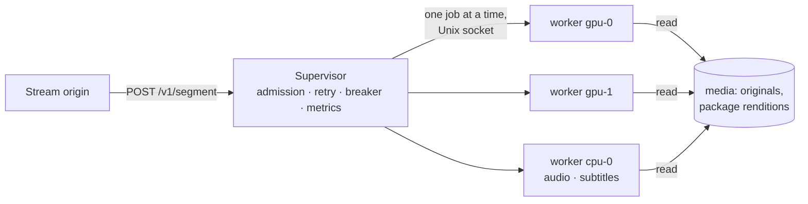

# live-worker

Live rungs for the zaentrum platform: the service that makes, segment by
segment, the renditions a stream origin serves beside a title's package
(ADR-0013, "live rungs beside the package, as a supervised safety net"). A
stream origin asks it for "rung *r*, segment *k* of source *s*" and gets one
CMAF fragment back; it never starts an encoder itself.

One **supervisor** process owns **N warm worker processes, one per encode
slot**. A worker keeps its GPU context, its decoders and its opened inputs
across jobs, and runs the FFmpeg 7.1 libraries in-process (decode, scale,
tone-map, encode) through go-astiav; the CMAF is written in Go with mp4ff. The
supervisor never links the media libraries: a crash, a kill at the memory
limit or a stall ends one worker process, which is started again while its
segment is made on another.



## Layout

```
cmd/live-worker/          the supervisor (the image's entrypoint; built without cgo)
cmd/live-worker-slot/     one warm worker process (cgo: the media libraries)
api/                      the wire contract: requests, results, error classes
client/                   a client of the API (the stream origin's, and the supervisor's of its workers)
cmaf/                     CMAF headers and fragments, written and read with mp4ff
internal/supervisor/      processes, lanes, admission, retries, hedging, breaker, metrics
internal/worker/          the worker: inputs, decoders, video, audio, subtitles, watchdog
internal/worker/ffx/      small cgo calls for what the binding lacks
internal/seg/             a package rendition's boundaries and edit list, read lazily
internal/media/           rung geometry, encoder settings, the AAC grid, frame rates
internal/subtitle/        text subtitle packets to WebVTT
internal/paths/           the media roots a source must lie under
internal/config/          the environment
internal/e2e/             the supervisor with real worker processes, through crashes
internal/testpkg/         a test packager (cuts an MP4 into a rendition)
testdata/                 synthetic test titles and the script that made them
docs/phase-1.md           taking the encoder out of the stream origin
```

## API

| Method | Path | Body | Answer |
|---|---|---|---|
| POST | `/v1/segment` | `api.Request` | the rung's init and the segment's fragment (`video/mp4`) |
| POST | `/v1/init` | `api.Request` without `segment` | the rung's init (`video/mp4`) |
| POST | `/v1/subtitle` | `api.SubtitleRequest` | the stream as WebVTT (`text/vtt`) |
| GET | `/v1/status` | | the slots, queues and open circuits (JSON) |
| GET | `/healthz` | | 200 while the supervisor runs |
| GET | `/readyz` | | 200 when every lane with slots has one up |
| GET | `/metrics` | | Prometheus |

`/v1/` takes `Authorization: Bearer <LIVE_WORKER_TOKEN>` when a token is set.

```json
POST /v1/segment
{
  "source":   {"rendition": "/media/library/…/hls/v0/playlist.m3u8", "frameRate": "24000/1001"},
  "track":    "video",
  "video":    {"width": 1280, "height": 720, "bitrateKbps": 3000, "tonemap": "auto"},
  "segment":  {"index": 7, "start": 42.0, "end": 48.0},
  "priority": "playhead",
  "deadlineMs": 12000
}
```

- **source** — `path`, a media file (an original), or `rendition`, a package
  rendition's media playlist, whose segments are read as one input. Either
  must be a regular file under one of `LIVE_WORKER_MEDIA_ROOTS`. `frameRate`
  (optional, a manifest's) is the title's rate, which goes into every SPS.
- **track** — `video` (with `video`: the frame and its bitrate; `width` 0
  keeps the aspect ratio) or `audio` (with `audio`: `stream`, the n-th audio
  stream of a file, and `bitrateKbps`, 160 by default): AAC-LC stereo, 48 kHz.
- **segment** — which segment and where it starts and ends, one of:
  `start`/`end` (seconds on the source's presentation; a file's timeline
  starts at zero, its container start time taken off), `cuts` (every
  segment's start; segment `index` runs to the next cut, the last to the
  source's end) or `"align": "package"` (a rendition's own segment `index`,
  its boundaries read from the media). `last` says the segment ends with the
  source. A segment holds the frames presented from the frame nearest its
  start to the frame nearest its end, starts with an IDR and has a closed
  GOP; consecutive segments, made by any processes, tile the timeline
  exactly. At most 20 s.
- **priority** — `playhead` (queues for a slot until its deadline) or
  `prefetch` (runs only on a slot to spare beyond `LIVE_WORKER_PREFETCH_RESERVE`,
  else 503 at once).
- **deadlineMs** — for queueing, retries and the job together.

The answer to a segment is the rung's **init followed by the fragment**: the
first `Live-Worker-Init-Length` bytes are the init (ftyp+moov), the rest the
fragment (styp+moof+mdat). Both come from one encoder, so they always fit; a
caller holding the rung's init compares `Live-Worker-Codec` (the hash of the
SPS/PPS or AudioSpecificConfig) with it. `Live-Worker-Result` is JSON
(`api.Result`: frames, span, path, timings), `Live-Worker-Attempts` how many
worker processes were tried.

A package rendition's fragments are written on its own (raw) timeline and the
init carries its edit list, so a player reads a live rung exactly as it reads
the package, whether it applies edit lists or not.

### Errors

A failure answers `api.ErrorBody` as JSON (`error`, `class`, `scope`,
`retryAfterMs`):

| Status | Class | Meaning | The caller |
|---|---|---|---|
| 400 | `bad-request` | malformed, or a path outside the media roots | fix the request |
| 401 | `unauthorized` | the token is missing or wrong | |
| 422 | `source` | the source cannot make it (unreadable, undecodable, ends early); `scope` `source` or `segment` | do not retry; remembered for `LIVE_WORKER_BREAKER_COOLDOWN` |
| 422 | `circuit` | the source failed `LIVE_WORKER_BREAKER_FAILURES` times lately | do not retry before `Retry-After` |
| 503 | `busy` | no slot before the deadline, the queue is full, or no slot to spare for a prefetch | retry after `Retry-After` |
| 504 | `deadline` | the deadline passed | |
| 502 | `internal` | every worker process tried failed (crashed, killed, an error of its own) | |

Retries across worker processes happen inside the supervisor; what is
answered has had them.

## How a job runs

1. A segment that failed for its source a moment ago is refused at once; so
   is every segment of a source whose **circuit** is open. The circuit opens
   after `LIVE_WORKER_BREAKER_FAILURES` failures of the source within
   `LIVE_WORKER_BREAKER_WINDOW` (distinct segments, or the source as a whole),
   stays open for `LIVE_WORKER_BREAKER_COOLDOWN`, then lets one trial through.
   A success forgets the failures: a bad segment of a good title is
   remembered on its own, not taken out on the title.
2. An identical job in flight is joined (`Live-Worker-Coalesced: true`).
3. **Admission**: video runs in the `gpu` lane, audio and subtitles in the
   `cpu` lane (each in the other when it has no slots). A slot is one worker
   process running one job: one encode session on the GPU. A playhead job
   takes an idle slot or queues (at most `LIVE_WORKER_QUEUE`); a prefetch job
   takes one only when more than the reserve are idle.
4. The job goes to the idle worker that last read the same source (its input
   and decoder are warm), else to any.
5. A worker's own watchdog ends a job with no progress for
   `LIVE_WORKER_STALL`, or past its deadline. The supervisor ends an attempt
   after `LIVE_WORKER_ATTEMPT_TIMEOUT`; a worker that does not then let go of
   the job within `LIVE_WORKER_KILL_GRACE`, says it is wedged, or grows past
   `LIVE_WORKER_SLOT_MAX_RSS_MB` is killed and started again.
6. What was not the source's fault (a crash, a kill, a timeout, a worker
   without an encode session) is tried on another worker, up to
   `LIVE_WORKER_ATTEMPTS`, within the deadline. With `LIVE_WORKER_HEDGE_AFTER`
   set, a playhead job that has not answered by then is started a second
   time on an idle slot, and the first answer wins.

## Configuration

All environment (defaults in parentheses):

| Variable | Default | |
|---|---|---|
| `LIVE_WORKER_LISTEN` | `:8090` | the HTTP address |
| `LIVE_WORKER_TOKEN` | (none) | bearer token `/v1/` requires |
| `LIVE_WORKER_MEDIA_ROOTS` | (required) | colon-separated folders sources must lie under, mounted at the paths the stream origin uses |
| `LIVE_WORKER_GPU_SLOTS` | `4` | GPU worker processes = encode sessions held; the pods sharing a GPU must stay within its session limit together |
| `LIVE_WORKER_CPU_SLOTS` | `2` | CPU worker processes (audio, subtitles; video when there are no GPU slots) |
| `LIVE_WORKER_HW` | `cuda` | the GPU slots' backend: `cuda`, `auto` (CUDA when a device opens, else the CPU), `none` |
| `LIVE_WORKER_GPU_DEVICE` | (none) | the CUDA device |
| `LIVE_WORKER_GPU_TONEMAP` | `auto` | HDR on CUDA: `auto` (all in GPU memory, then through system memory, then zscale on the CPU), `interop`, `roundtrip`, `cpu` |
| `LIVE_WORKER_QUEUE` | `16` | playhead jobs that may wait for a slot, per lane |
| `LIVE_WORKER_PREFETCH_RESERVE` | `1` | idle slots a prefetch job leaves free |
| `LIVE_WORKER_DEADLINE` | `12s` | a segment or init request's deadline when it names none |
| `LIVE_WORKER_MAX_DEADLINE` | `120s` | the longest a request may ask for |
| `LIVE_WORKER_SUBTITLE_DEADLINE` | `120s` | a subtitle request's default |
| `LIVE_WORKER_ATTEMPTS` | `3` | worker processes a job is tried on |
| `LIVE_WORKER_ATTEMPT_TIMEOUT` | `8s` | one attempt of a segment or init job |
| `LIVE_WORKER_HEDGE_AFTER` | `0` (off) | start a second attempt of a slow playhead job on an idle slot |
| `LIVE_WORKER_STALL` | `5s` | progress watchdog: a job with no progress for this long ends |
| `LIVE_WORKER_KILL_GRACE` | `3s` | how long a worker has to let go of a job given up on |
| `LIVE_WORKER_SLOT_MAX_RSS_MB` | `0` (none) | kill a worker process above this resident set |
| `LIVE_WORKER_BREAKER_FAILURES` | `3` | failures that open a source's circuit |
| `LIVE_WORKER_BREAKER_WINDOW` | `1m` | within this |
| `LIVE_WORKER_BREAKER_COOLDOWN` | `30s` | how long it stays open; how long a failed segment is remembered |
| `LIVE_WORKER_DECODE_THREADS` / `_ENCODE_THREADS` / `_FILTER_THREADS` | `0` (the libraries' default) | per job |
| `LIVE_WORKER_CPU_THREADS` | `2` | threads per job in the CPU lane, where the three above are 0 |
| `LIVE_WORKER_EXTRA_HW_FRAMES` | `8` | decoder hardware frames beyond its own pool |
| `LIVE_WORKER_FFMPEG_LOGLEVEL` | `error` | `quiet` … `debug` |
| `LIVE_WORKER_SHUTDOWN_GRACE` | `10s` | on SIGTERM, how long running jobs may finish |
| `LIVE_WORKER_START_TIMEOUT` | `60s` | a worker process to healthy (CUDA set-up included) |
| `LIVE_WORKER_SLOT_BIN` | `live-worker-slot` | the worker binary |
| `LIVE_WORKER_SOCKET_DIR` | a temporary folder | where the workers' Unix sockets go |
| `LIVE_WORKER_TEST_FAULTS` | (none) | tests only: failures every worker has (`crash-after:N`, `stall-after:N`, `leak:MBPS`) |

## Metrics

`live_worker_requests_total{kind,track,result}`,
`live_worker_request_duration_seconds{kind,track,result}` (queueing and
retries included), `live_worker_job_seconds{lane,track}` (the time in the
worker), `live_worker_queue_wait_seconds{lane,priority}`,
`live_worker_attempts_total{lane,outcome}`,
`live_worker_slot_restarts_total{lane,reason}` (exit, rss, wedged, drain,
broken, start), `live_worker_inflight{lane}`, `live_worker_queued{lane}`,
`live_worker_slots{lane,state}`, `live_worker_slot_rss_bytes{slot}`,
`live_worker_slot_info{slot,lane,backend,ffmpeg}`,
`live_worker_circuits_open`, `live_worker_circuit_transitions_total{to}`,
`live_worker_coalesced_total`, `live_worker_hedges_total{outcome}`, and the
Go and process collectors.

## What the code knows

From the spike that chose this design (ten titles on a consumer GPU, 1,960
segments checked frame by frame against the packages' boundaries, 25 of 25
crash recoveries):

- **go-astiav is frozen at v0.39.0**, its last release for FFmpeg 7.x;
  moving it moves FFmpeg (and its NVENC API) along.
- **Hardware decoding uses slice threads.** The binding finds its
  `get_format` callback by the codec context's address; libavcodec's frame
  threads call it on copies of the context, where it is never found.
- **Boundaries come from the media**, not from `EXTINF`, which runs ahead of
  the media by the reordering delay.
- **Edit lists.** A packager starts the presentation with an edit list
  (video: the first frame's composition offset; audio: the encoder's
  priming). Requests are on the presentation; a rendition's fragments are
  stamped on its raw timeline and its init copies the edit list.
- **AAC renditions are not on a 1024-sample grid** (frames of 1016 samples
  occur): audio is placed on the grid by position, frame *n* of segment
  `[s, e)` being `round(s·48000/1024) ≤ n < round(e·48000/1024)`, encoded
  from four frames earlier.
- **The frame rate in the SPS is the title's** (snapped to a standard rate),
  never a demuxer's estimate from one window: every segment's SPS must be the
  init's.
- **Open GOPs** are decoded from the segment before (decode and drop).
- **x264 with sliced threads is not bit-exact** from run to run: a retried
  segment has the same frames, timestamps and SPS, not the same bytes.
- `avc.GetParameterSetsFromByteStream` loses a header's last NAL unit;
  `cmaf.ParamSets` does not.
- **Memory limits are resident-set limits.** `RLIMIT_AS` stops a CUDA process
  from starting (CUDA reserves address space), and macOS does not enforce it.
- **Vulkan in a GPU container** needs the Khronos 1.4 loader, libX11 and
  libXext (the driver's ICD links them), glvnd/EGL and
  `NVIDIA_DRIVER_CAPABILITIES=all`; without Vulkan, HDR is tone-mapped on the
  CPU and the worker's note says so (`/v1/status`).
- **HDR on the GPU stays in GPU memory**: FFmpeg 7.1's `hwupload` takes only
  its own device's frames, so the worker moves frames CUDA→Vulkan→CUDA itself
  around libplacebo, where the command line goes through system memory.

## Local development

The worker links FFmpeg 7.1's shared libraries through pkg-config; the
supervisor needs none.

```sh
taskpolicy -b scripts/build-ffmpeg.sh $PREFIX    # FFmpeg 7.1.5 + x264 + zimg, shared (or unpack the image's BtbN build)
. scripts/env.sh $PREFIX
go build -o bin/ ./cmd/...
go test ./...                                    # the CPU path: libx264, swscale, zscale
CGO_ENABLED=0 go test ./api/... ./client/... ./cmaf/... ./internal/supervisor/... ./internal/seg/...   # without FFmpeg
LIVE_WORKER_MEDIA_ROOTS=$PWD/testdata LIVE_WORKER_GPU_SLOTS=0 LIVE_WORKER_HW=none \
  LIVE_WORKER_SLOT_BIN=bin/live-worker-slot bin/live-worker
```

The supervisor's tests run it against fake worker processes (the test binary
itself), so they need no FFmpeg; `internal/worker` and `internal/e2e` run the
real worker on the CPU and are what CI runs against the image's FFmpeg build.
`testdata/make.sh` remakes the test titles.

## Build the container

```sh
docker build -t live-worker .
```

The image is `nvidia/cuda:12.3.2-runtime-ubuntu22.04` with BtbN's FFmpeg
n7.1.5 shared build (pinned archive, checked against its sha256), Khronos's
Vulkan loader 1.4.350 built in a stage, glvnd/EGL/GL/GLX, libX11 and libXext,
and `NVIDIA_DRIVER_CAPABILITIES=all`; it runs as a numeric user. A private
mirror passes `--build-arg BASE=<registry>/library/` (and `LOADER_BASE` for
the loader stage's `ubuntu:22.04`). It needs an NVIDIA GPU and driver, the
container toolkit, and the media mounted read-only at the paths the stream
origin uses. CI publishes it as `ghcr.io/zaentrum/live-worker`.

## License

[MPL-2.0](LICENSE).
