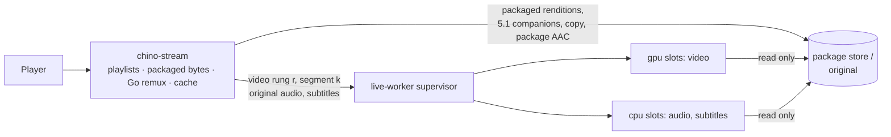
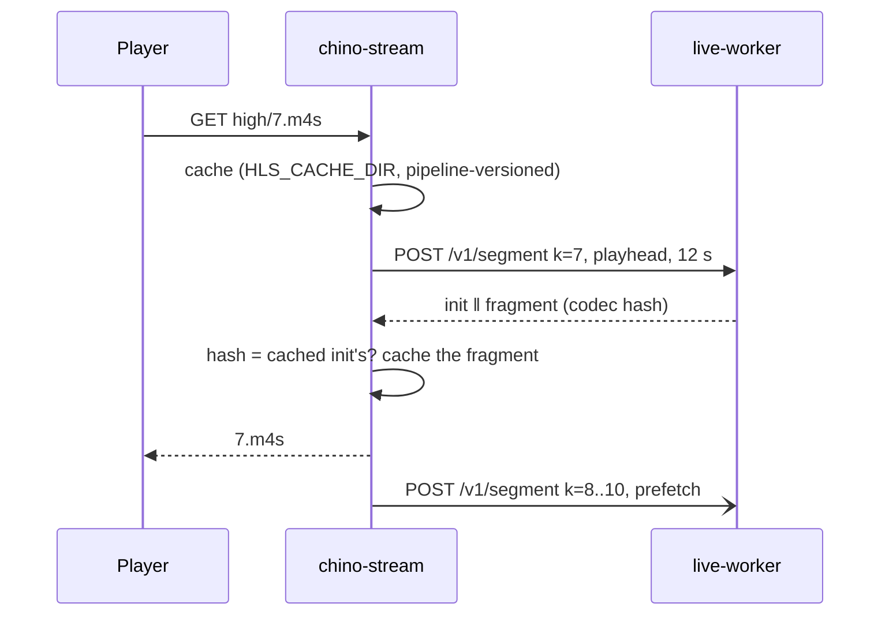

# Phase 1: the encoder leaves the stream origin

ADR-0013 (live rungs beside the package, as a supervised safety net) was
accepted on 2026-10-20. Its first phase is isolation: **chino-stream starts no
encoder**. Today it runs ffmpeg as child processes in the container that
serves every packaged stream, so an encoder that runs away or is killed for
memory takes static playback down with it. In phase 1 every live encode moves
to this repository's service: a supervised pool of warm worker processes,
one per encode slot. Phase 1 changes no client: the owner has frozen UI
changes, so the playlists and the quality menu a player gets stay what they
are.

This note maps every path in chino-stream (at `99516d7`) that runs ffmpeg or
ffprobe, says how each is served without an encoder in chino-stream, gives
the worker's contract and how chino-stream calls it, and the rollout.

## 1. What runs ffmpeg or ffprobe today

Seven places start a process; everything else that "transcodes" reaches one
of them.

| # | Where | Runs | Called from |
|---|---|---|---|
| 1 | `internal/play/hls.go:1450` `runFFmpeg` | `ffmpeg` (any args) | video windows (`hls.go:1063`, via `window.go:351`), audio windows (`hls.go:1164`), the stream copy's init (`passthrough.go:370`) and segments (`passthrough.go:469`) |
| 2 | `internal/play/transcode.go:144` `BuildFFmpeg` | `ffmpeg … -f mp4 pipe:1` | the progressive `/api/play/{id}` (`handler.go:730`) |
| 3 | `internal/play/transcode.go:177` `BuildEmbeddedSubtitleFFmpeg` | `ffmpeg -map 0:s:N -c:s webvtt` | embedded subtitles (`handler.go:359`, `:424`) |
| 4 | `internal/play/aac.go:53` `DetectAACEncoder` | `ffmpeg -encoders` | startup (`internal/http/router.go:60`), gates `/readyz` |
| 5 | `internal/play/ffprobe.go:360` `RunFFprobe` | `ffprobe -show_format -show_streams` | `resolveSource` (`hls.go:231`, cached per path and mtime), `Play` (`handler.go:111`), `Info` (`handler.go:568`) |
| 6 | `internal/play/passthrough.go:196` `probeDurationMs` | `ffprobe … format=duration` | the stream copy's plan |
| 7 | `internal/play/passthrough.go:223` `probeKeyframes` | `ffprobe -skip_frame nokey` | the stream copy's plan, when the original is not an MP4 mp4ff can read |

`ladder.go` and `rung.go` run nothing: `ladder.go` filters a packaged master
for a client; `rung.go` computes what a transcode rung encodes and advertises
(`transcodeGeometry`, `transcodeBandwidth`). They stay, and in phase 1 they
feed the worker's request, so the frame encoded is the one the master's
`RESOLUTION` names. `QualityLadder` (`transcode.go:23`) keeps its names; its
CRF values go with the off path.

### The paths, one by one

**A. On-the-fly video, in windows.** `GET …/{high|medium|low}/index.m3u8`,
`init.mp4`, `{n}.m4s` (and the same under `/extras/{extraId}/`).

- *Trigger*: the master's on-the-fly branch (`Master` → `serveOnTheFlyMaster`),
  taken when `playablePackage` finds nothing to serve: a title with no
  package (not packaged yet, or its package not complete), or a client that
  decodes none of the package's rungs at its height (packages are HEVC; an
  H.264-only client, or an HEVC cap below the package's height). For an
  original still on disk, `DecideWith` must say transcode (video codec not
  in the client's set) or remux (audio codec, channels or container not
  taken; remux re-encodes the video too, there is no video copy on this
  path), or the client picked a lower quality (`q=medium|low`, the quality
  menu `/info` offers for transcode). A package source (the original
  retired) is always a transcode. An extra is a package, so the same.
- *Input*: the original, `-ss <window start> -i <file>`; or the package's top
  video rendition, read as `concat:init.mp4|seg-N.m4s|…` (the window and one
  second before it) with `-seek_timestamp 1 -ss <start>`.
- *Segmenting*: a fixed grid, 6-s segments (`segmentSec`), ten per ffmpeg run
  (`windowSize`, 60 s); keyframes forced at `6n` (`-force_key_frames`), the
  HLS muxer cutting at them; each window's `tfdt` re-biased by its start when
  installed (`window.go`). The playlist is `floor(d/6)` segments of
  `#EXTINF:6.000` and a tail when it is over 0.5 s, from the probe's
  duration. These are not the package's boundaries.
- *Encode*: high is the source's size inside the 1920×1080 box (or the
  device's height cap), medium 720 lines, low 480, never upscaled
  (`transcodeGeometry`). NVENC (VBR, CQ 23) with `USE_NVENC`, except HDR at
  1080p or less, which goes to libx264 (CRF 23/26/28, `veryfast`,
  `zerolatency`) to be tone-mapped with zscale; HDR above 1080p stays on
  NVENC untone-mapped (desaturated). H.264 High, level 4.0.
- *Output*: CMAF init and segments in `HLS_CACHE_DIR` (keyed by the source,
  the rung and the height cap), served `immutable`, swept after two hours.
  A window that fails twice in two minutes answers 404, so the player falls
  back; three runs at once (`FFMPEG_MAX_CONCURRENT`), two more for warms.

**B. On-the-fly audio, in windows.** `GET …/audio/{n}/index.m3u8`,
`init.mp4`, `{seg}.m4s`.

- *Trigger*: every on-the-fly master except the stream copy lists one audio
  rendition per stereo track (a package's 5.1 companions are served as
  packaged and are not this path).
- *Input*: the original's `0:a:N`, or the package's stereo AAC rendition N.
- *Segmenting*: the same 6-s grid in 60-s windows.
- *Encode*: AAC-LC, stereo (downmixed), 48 kHz, 160 kb/s. For a package
  source this re-encodes audio that already is AAC-LC stereo.
- *Output*: as A.

**C. Warms.** `Master` and `POST /prewarm` start window 0 (or the window of
`?t=`) of the rung the client starts on and of its default audio track in
the background (`warmOnTheFly` → `warmTranscode`), and for a stream copy its
plan and init (`warmCopy`). Same pipelines, the warm slots.

**D. Stream copy.** `GET …/copy/index.m3u8`, `init.mp4`, `{n}.m4s`.

- *Trigger*: an original whose video, audio (stereo, or multichannel with
  `aacmc`) and container the client takes, at `q` empty or high. Never a
  package.
- *Input*: the original.
- *Segmenting*: its keyframes, grouped into segments of at least 6 s; read
  from the MP4's `stss`/`stts` with mp4ff, else with ffprobe (#7) reading
  the whole file.
- *Encode*: none. ffmpeg runs as a muxer: the init with `-t 0.05 -c copy`,
  each segment with `-copyts -ss -t -c copy`, video and the first audio
  track in one fragment.

**E. Progressive playback.** `GET /api/play/{id}`: ffprobe (#5), then the
file by byte ranges (passthrough), or ffmpeg (#2) re-encoding (transcode) or
copying the video and re-encoding the audio (remux) into one fragmented MP4
piped at real time (`-re`), from `-ss <t>`. Taken with `?t=`,
`?force_transcode=1` or codecs the default set does not take. No client
requests it: chino-web, chino-androidtv, chino-mobile and chino-tizen play
the HLS master. chino-api still proxies the route.

**F. Embedded subtitles.** `GET /api/play/{id}/subtitles/{n}.vtt?t=`, which
chino-web, chino-mobile and chino-tizen mount for a source's own text tracks.

- *Input*: the original's subtitle stream `0:s:N` (text formats; a bitmap one
  fails), or, with the original retired, the package's WebVTT of that stream.
- *Segmenting*: none: the whole track, cues from `t` on, shifted by `t`.
- *Encode*: ffmpeg's WebVTT subtitle encoder, also for the package's file,
  which already is WebVTT.
- *Output*: WebVTT, cached per source, stream and `t`.

**G. The probe** (#5): codecs, sizes, colour, duration and tracks of an
original, for every on-the-fly master, playlist and segment (cached five
minutes), `/info` (which chino-api also calls) and progressive playback. A
package's probe is its manifest (`packageProbe`): no ffprobe.

**H. The AAC check** (#4): which AAC encoder the ffmpeg build has; `/readyz`
answers 503 without one.

## 2. Phase 1: each path without an encoder in chino-stream

| Path | Phase 1 | Where |
|---|---|---|
| A video windows | one **worker job per segment**, same grid, same playlist | live-worker, `gpu` lane |
| B audio of an original | one **worker job per segment** | live-worker, `cpu` lane |
| B audio of a package | **remux**: the package's own AAC re-cut on the grid | chino-stream, Go (mp4ff) |
| C warms | the same jobs at **prefetch** priority | live-worker |
| D stream copy | **remux**: init and fragments from the original's sample tables, by byte range | chino-stream, Go (mp4ff) |
| E progressive, transcode or remux | **gone**: 404, as for a package source today; byte ranges of the original stay | chino-stream |
| F subtitles of an original | **worker job**: the stream demuxed, its packets turned into WebVTT in Go | live-worker, `cpu` lane |
| F subtitles of a package | **Go**: the package's WebVTT, its cues shifted by `t` | chino-stream |
| G probe | **stays** (see below) | chino-stream, ffprobe |
| H AAC check | **gone**: nothing in chino-stream encodes audio | |



**Per-segment worker jobs (A, B, C).** Each request is "rung *r*, segment *k*
of source *s*": the worker decodes from the keyframe before the segment,
drops the frames before it, encodes with a fresh encoder whose first frame is
an IDR, and answers the rung's init with the fragment. Any worker makes the
same segment (frames, timestamps and parameter sets), so a failed one is made
again elsewhere and a crash costs a retry, not a stream: the spike recovered
25 of 25 crashes, kills, memory kills and stalls with the right fragment,
about 1.7 s after the failure. The 60-s windows go, and with them the window
seams, the window failure budget and the "ffmpeg exited 0 without seg N"
retries: a worker refuses a video segment the source cannot fill (422) rather
than returning a short one (audio that ends early is padded with silence, as
a title's audio often is shorter than its video).

**Remux and byte ranges (B for a package, D).** These need no encoder, and
not the worker: they are box plumbing, which ADR-0013 gives to Go.

- A package's stereo AAC rendition is AAC-LC stereo already. Every AAC frame
  is a sync sample, so `audio/{n}/{k}.m4s` is the rendition's frames
  presented in `[6k, 6k+6)` (the frame nearest each boundary starting a
  segment, as the video), written as a fragment with their own timestamps,
  and `audio/{n}/init.mp4` is the rendition's own init, edit list included.
  The URIs and the playlist stay; the bytes are the package's audio, not a
  second-generation encode of it.
- The stream copy keeps its plan (mp4ff's keyframes, as today). Its init is
  built from the original's `moov` (the video track's and the first audio
  track's sample entries as they are, an `mvex`, the original's edit lists),
  its segment *n* from the samples of plan segment *n* (the audio by time),
  read by byte range and written with their own timestamps, as `-copyts`
  wrote them. A fragmented original's keyframes come from its `trun` flags.
  An original mp4ff cannot read (MPEG-TS, FLV) is treated as needing
  repackaging, as Matroska already is: it takes the transcode ladder (remux,
  no quality menu, as today for Matroska), so neither ffmpeg nor ffprobe #7
  is needed for it.

**Progressive transcode (E) goes.** It is the one path that cannot be cut
into stateless segment jobs (one long response at real time), and nothing
requests it. With the flag on it answers 404 "progressive transcoding moved to
HLS", as it answers a package source today; passthrough by byte ranges stays.

**Subtitles (F).** The worker's `POST /v1/subtitle` demuxes the subtitle
stream (the media libraries, in a worker process) and turns its packets into
WebVTT cues in Go: SubRip (italic, bold, underline kept), ASS/SSA (overrides
dropped, `\N` as a line break), WebVTT, mov_text and plain text, cues from
`t` on, shifted by `t`. A bitmap stream (PGS, VobSub, DVB) answers 422, which
chino-stream answers 502 as its failed extraction does today. A package's
subtitle is a WebVTT file: chino-stream shifts its cues itself (it already
parses SubRip in Go, `srt.go`).

### Boundaries for a source that has no package

**Decision: a fixed duration, today's 6-s grid, cut at the frame nearest each
boundary. No keyframe cut list.**

- A transcode can cut anywhere. Each segment is encoded by a fresh encoder
  whose first frame is an IDR, so the source's keyframes do not constrain
  where it starts; the worker decodes from the keyframe before the boundary
  and drops what is before it (an open GOP from the segment before). The cost
  is at most one source GOP of decoding per segment, which on the GPU's
  decoder is small.
- The playlist must stay. Today's on-the-fly playlist is `floor(d/6)` ×
  `6.000` and a tail, made from the duration before any segment exists. A
  cut list would change every `EXTINF`.
- A cut list costs a read of the whole file before the first playlist: the
  keyframes of a Matroska original are spread through it (`probeKeyframes`
  reads it all, minutes for a large file on a network share). The grid needs
  the duration only.
- Every rung of a title shares the grid, so in phase 2 the live rungs of an
  unpackaged title switch among themselves as a package's rungs do.

Exactly: segment *k* is `[6k, min(6k+6, d))` seconds on the source's
presentation timeline with the container's start time taken off (what
ffmpeg's output was, without `-copyts`), and the last one has `last` set. It
holds the frames presented from the frame nearest `6k` (presentation time ≥
`6k` − half a frame) to the frame nearest `6(k+1)`, and spans from its first
frame to the next segment's first frame, so the segments tile the timeline
exactly whichever processes made them. Its audio is the AAC frames
`round(6k·46.875)` to `round(6(k+1)·46.875)` of the 48 kHz grid. A tail of
0.5 s or less, which today's playlist leaves out, stays out.

A **keyframe cut list** is what a stream copy needs, and the worker takes one
(`segment.cuts`): in phase 2, an unpackaged title's copy variant and its live
rungs would share the copy plan's boundaries. A **package's own boundaries**
(`segment.align: "package"`, read from its segments' media) are phase 2's for
packaged titles. Phase 1 uses neither.

### What stays in chino-stream: ffprobe

**Decision: the header probe (`RunFFprobe`) stays, the last child process of
chino-stream in phase 1. The duration probe (#6), the keyframe probe (#7) and
the AAC check (#4) go.**

- It is not an encoder, which is what phase 1 takes out (ADR-0013: "no
  encoder in the stream origin", "no encoder linked into a serving
  process"). It runs as its own process, reads headers only
  (`-show_format -show_streams`), is bounded by a 10-s timeout and cached:
  a crash or a hang ends the probe, not chino-stream.
- It is needed where nothing is encoded: the stream copy, `/info` (which
  chino-api calls too), the master of every on-the-fly title. Sending it to
  the worker would make those depend on the worker being up, the reverse of
  the isolation phase 1 is for: with the worker down, only live encodes
  should fail.
- #6 is redundant (the probe has the duration), #7 is replaced by mp4ff (and
  by treating what mp4ff cannot read as remux), and #4 has nothing left to
  check.

Its exit is later: a probe job on the worker's CPU lane, or the probe
recorded when a title is ingested, so that chino-stream has no child process
at all, as ADR-0013's consequences say. Until then chino-stream's image keeps
the `ffprobe` binary.

## 3. The worker's contract

The contract is the `api` package of this repository (`github.com/zaentrum/live-worker/api`),
which chino-stream imports, with `client`; the README has the details.

```json
POST /v1/segment
{
  "source":   {"rendition": "/…/versions/<v>/hls/v0/playlist.m3u8", "frameRate": "24000/1001"},
  "track":    "video",
  "video":    {"width": 1280, "height": 720, "bitrateKbps": 3000, "tonemap": "auto"},
  "segment":  {"index": 7, "start": 42, "end": 48},
  "priority": "playhead",
  "deadlineMs": 12000
}
```

- **Request.** `source`: an original (`path`) or a package rendition
  (`rendition`, its media playlist) under the worker's media roots, and the
  title's frame rate when known (a manifest's `frameRate`: it goes into every
  segment's SPS, and given here the worker need not read every segment to
  work it out). `track` `video` with the rung (`width`×`height`, the bitrate)
  or `audio` with the stream and bitrate. `segment`: its index and its
  boundary (`start`, `end`, `last`), or a cut list (`cuts`), or
  `align: "package"`. `priority`: `playhead` or `prefetch`. `deadlineMs`.
- **Response.** `200` `video/mp4`: the rung's **CMAF init followed by the
  fragment** (styp+moof+mdat); `Live-Worker-Init-Length` splits them,
  `Live-Worker-Codec` is the hash of the init's parameter sets,
  `Live-Worker-Result` says frames, span, pipeline and timings. Both come
  from one encoder. `POST /v1/init` answers the init alone.
- **Errors** (`{"error", "class", "scope", "retryAfterMs"}`):
  **422** `source` (the source cannot make it: unreadable, undecodable, ends
  before the segment does; `scope` `source` or `segment`) and `circuit` (the
  source failed three times lately), **503** `busy` (no slot before the
  deadline, the queue full, or no slot to spare for a prefetch; `Retry-After`),
  **504** `deadline`, **400** a bad request or a path outside the media roots,
  **502** every worker tried failed.

## 4. How chino-stream calls it



- **The request** for rung *q* of a source: `video.width`×`height` from
  `transcodeGeometry(ql, w, h, cap)` (the master's `RESOLUTION`), `bitrateKbps`
  = `transcodeBandwidth(rung, w, h, false)` / 1000 (the master's `BANDWIDTH`
  less the audio), `tonemap` `auto`; `source.path` the original, or
  `source.rendition` the package's top video rendition with the manifest's
  `frameRate`; `segment` the grid above. Audio of an original: `audio.stream`
  the track, 160 kb/s.
- **Timeouts.** `deadlineMs` 12 s for a playhead segment (room for a retry
  after a crash, which the spike saw back in about 1.7 s), 10 s for an init, 30 s for a prefetch, 120 s for a
  subtitle; the HTTP call gives up 2 s after the deadline; connecting 2 s.
- **Retries.** None for 422, 504 or 502: the supervisor has retried on other
  workers already. A 503 on a playhead request is retried once after
  `Retry-After` when the deadline allows; a refused or reset connection (the
  service restarting) once after 200 ms.
- **Hedging** is the supervisor's (`LIVE_WORKER_HEDGE_AFTER`, off at first):
  it sees which slots are idle; a hedge from chino-stream would take a second
  slot blind.
- **To the player**: 422 → 404 (today's answer for a window given up on:
  players fall back at once on a 4xx instead of retrying), 503 → 503 with
  `Retry-After`, 504 → 504, 502 → 502 (today's failed run).
- **Prefetch ahead of the play head.** Serving segment *k* of a rung at
  playhead priority, chino-stream asks for *k*+1 … *k*+3 (about 18 s) at
  prefetch priority unless cached or in flight, and the same for the audio
  of an original; a session no segment was asked for in 20 s (today's
  `windowIdle`) gets no more. The master's and `/prewarm`'s warm is the init
  and the first three segments from `t`, at prefetch priority. A prefetch the
  worker has no spare slot for is dropped, not queued.
- **Init.** `init.mp4` is `POST /v1/init`, cached. Every segment arrives with
  its init: chino-stream compares the codec hash with the cached init's, and
  a fragment that would not decode with the player's init is refused and
  asked for once more (else 502).
- **One request in flight** per source, rung and segment in chino-stream, as
  its window productions are deduplicated today; the supervisor joins
  identical jobs as well.
- **A short-lived cache**: the existing one (`HLS_CACHE_DIR`, swept after two
  hours), its folders versioned by pipeline (`high-lw1`, `audio-0-lw1`), so a
  flag change never serves one pipeline's segment under the other's init.

## 5. Rollout

A flag per instance (one platform deployment at a time), with today's ffmpeg
path as its off position until the flag is proven:

- `LIVE_WORKER=off|shadow|on`, `LIVE_WORKER_URL`, `LIVE_WORKER_TOKEN`
  (chino-stream).
- **A session keeps its pipeline.** The on-the-fly master writes `lw=1` into
  its URIs when it sends the session to the worker, as it writes `v=` for a
  package version; every request of the session carries it, and chino-stream
  serves it accordingly. A segment never meets an init of the other pipeline,
  whichever way the flag turns or whichever instance answers: a flip changes
  new sessions only, and a session in flight at a restart ends on the
  pipeline it began on. This query parameter is the only change to the
  master's text; clients copy URIs as they are, as they do with `v=`.

Steps:

1. **Deploy** live-worker (its own deployment: a GPU, the media read-only at
   the paths chino-stream uses, the token), with no traffic. Check
   `/readyz`, `/v1/status` (each slot's backend; Vulkan for HDR) and the
   metrics.
2. **Shadow** on one instance: chino-stream still serves ffmpeg's segments,
   and asks the worker for the same segments at prefetch priority, checking
   and dropping what comes back (frames for the grid, a stable codec hash
   per rung, timings). The worker meets real titles and load, and no viewer
   depends on it.
3. **On** for one instance, then the others: new sessions on the worker,
   those in flight end on ffmpeg.
4. **Proven** after two weeks on everywhere with no session failing for the
   worker's sake, the on-the-fly start time and stall rate (the player
   telemetry chino-api collects) no worse than with ffmpeg, the worker's p95
   per segment under 2 s on the GPU, and every restart accounted for.
5. **Remove** the off path: the window pipeline (`window.go`,
   `windowbudget.go`, `transcodeVideoWindow`, `transcodeAudioWindow`), the
   stream copy's ffmpeg, `BuildFFmpeg`, `BuildEmbeddedSubtitleFFmpeg`,
   `DetectAACEncoder`, the `FFMPEG_*`, `USE_NVENC` and `NVENC_*` settings, the
   `ffmpeg` binary in the image (`ffprobe` stays), the `lw` pin, and the GPU
   chino-stream's pod requests: it encodes nothing.

Rollback is the flag: off sends new sessions to ffmpeg again, while sessions
pinned to the worker go on there as long as it answers.

## 6. What the player sees

Nothing. The master is the same but for the `lw` pin; the media playlists
keep the 6-s grid, the `EXTINF` values and the URIs; `CODECS`
(`avc1.640028`, `mp4a.40.2`), `RESOLUTION`, `BANDWIDTH` and `VIDEO-RANGE=SDR`
are the same, as is the quality menu (`/info`'s high, medium and low for a
transcode); every segment starts with an IDR, as before; a failure answers
the statuses it answers today. What differs is inside the segments: the
bitrate is held to the one `BANDWIDTH` advertises (today the quality is held
and the bitrate varies), HDR is tone-mapped above 1080p too (on the GPU), and
Dolby Vision profile 5 is reshaped, where today it is left desaturated or
tone-mapped without its reshaping; a package's audio is the package's, not a
re-encode. No client changes.

## 7. Not in phase 1

- The virtual ladder (phase 2): live rungs in the packaged master on the
  package's boundaries (`align: "package"`), the player switching by its own
  bandwidth estimate, the long-link test and the player's progress watchdog.
  Phase 1's request already carries what phase 2 needs; for an original
  feeding a packaged title's rungs, the request will also carry the
  package's timeline (its edit shift), so their fragments line up with the
  package's for players that ignore edit lists.
- The lowest rung on the CPU when the GPU is saturated. A rung's segments must
  all come from one kind of encoder: their parameter sets have to be the
  init's. It needs a rung pinned to the CPU (or in-band parameter sets), and
  load data from phase 1 to size it.
- The probe out of chino-stream (above), and Go-native muxing beyond the two
  remuxes here: later phases.

## Appendix: the worker

`live-worker` (this repository) is the spike's warm worker, promoted: go-astiav
v0.39.0 on FFmpeg 7.1.5, the CMAF written with mp4ff, the edit-list handling,
the open-GOP, frame-rate and AAC-grid fixes, and the image that runs on the
GPU nodes (Khronos's Vulkan loader 1.4.350, glvnd/EGL, libX11/libXext,
`NVIDIA_DRIVER_CAPABILITIES=all`). Around it: a supervisor that owns one
worker process per encode slot (crash isolation is the process boundary), a
`gpu` lane for video and a `cpu` lane for audio and subtitles, admission by
encode slots with playhead jobs first and prefetch on spare slots only, the
worker's progress watchdog and deadlines, kills at a resident-set limit, on a
wedged job and on a job not let go of, retries elsewhere, optional hedging,
a circuit breaker per source (a bad segment of a good title is remembered on
its own), identical jobs joined, and Prometheus metrics. Two additions over
the spike for phase 1: a file's timeline starts at zero (its container start
time taken off, as the command line's did), so the grid lines up with
today's playlists; and a segment ends at the next segment's first frame,
so a fixed grid tiles as exactly as a package's boundaries do. Its tests run
the worker on the CPU (libx264, swscale, zscale) and the supervisor against
crashing, stalling and leaking worker processes.
